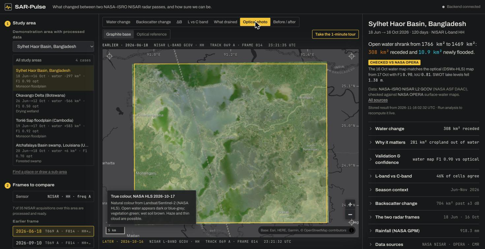
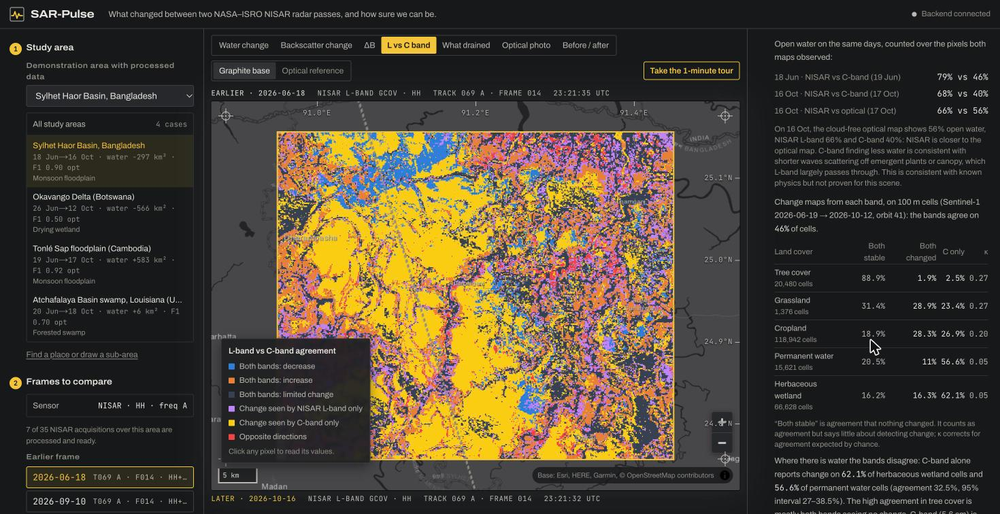
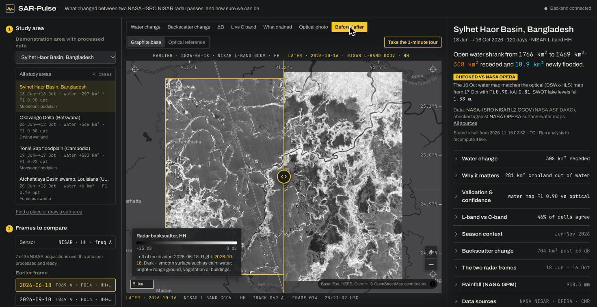
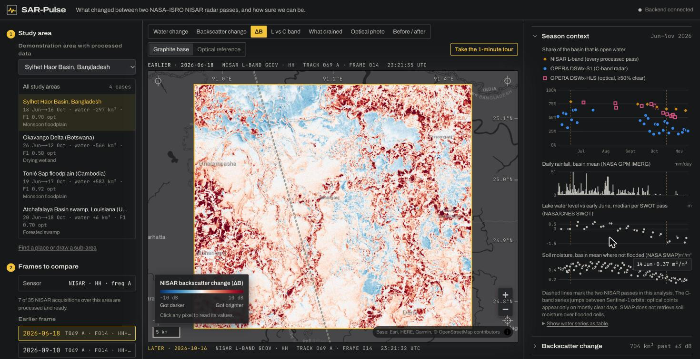
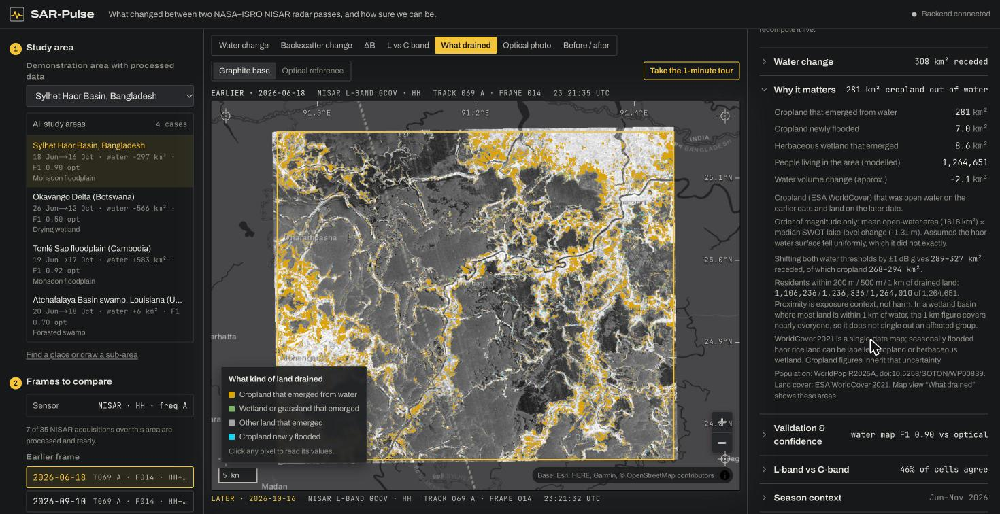
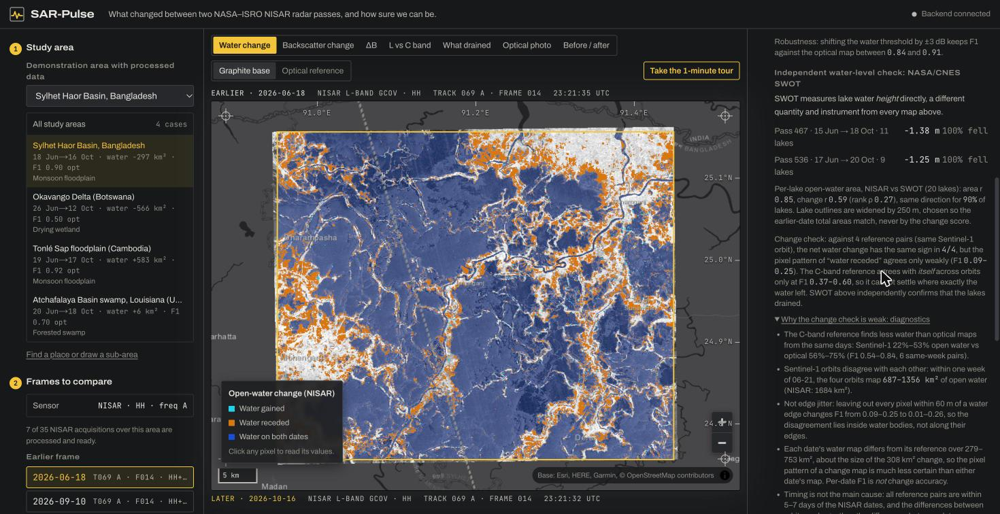
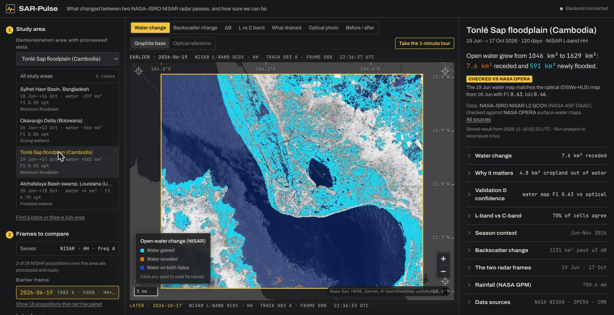

<!--
SAR-Pulse: final seven-slide presentation.
- Slides are separated by "---". Renders in Marp, Slidev or reveal.js; imports into Google Slides / PowerPoint.
- HTML comments hold speaker notes, the visual, the evidence for every number and the main judging criterion.
- Every number is listed with its source in docs/evidence.md, generated by scripts/verify_claims.py from the
  stored outputs that the live API serves (https://nasa-spaceapps-2026.vercel.app).
- Comparison radar is Sentinel-1 C-band via NASA OPERA RTC-S1. RCM was not obtained and is not claimed.
- No field ground truth exists for any number here. All references are other satellite products.
-->

# Beyond the Surface

### Every monsoon the Sylhet haor wetlands flood, then drain for months. When and where the land re-emerges decides when 1.26 million people's farms can plant boro rice, and clouds hide it from optical satellites.

- **2,237 km²** of seasonal wetland in north-east Bangladesh, home to **≈ 1.26 million people** (WorldPop 2025, modelled).
- Boro rice, Bangladesh's main rice crop, is planted as water recedes in November–December.
- Radar sees through cloud. NASA–ISRO **NISAR** (launched 2025) brings L-band radar every 12 days.

**Question:** how much of the wetland drained between monsoon high water (18 Jun) and mid-October (16 Oct) 2026, how sure can we be, and what does L-band see that C-band does not?

<!--
VISUAL: s1-sylhet-optical.jpg. Live app, Sylhet, "Optical photo" view (NASA HLS true colour, 17 Oct) with the results headline.
EVIDENCE: basin 2,237 km² (water_change.tif valid pixels); population 1,264,651 (WorldPop R2025A via diagnostics D_impact). docs/evidence.md rows "Basin analysed", "People living in the basin".
CRITERION: Impact and Relevance (a real, recurring decision that depends on water timing; NISAR is the core data).
SAY: "This is a problem of timing under clouds. Radar is the only way to watch it continuously."
-->

---

# Two Wavelengths, Different Perspectives

### L-band and C-band radar disagree systematically, and where they disagree depends on the surface

| Land cover (100 m cells) | Sylhet (draining) | Okavango (drying) | Tonlé Sap (flooding) | Atchafalaya |
|---|---|---|---|---|
| **Open water**: change seen by C-band only | **57%** | n/a | **58%** | 25% |
| Open water: change seen by L-band only | 7% | n/a | 1% | 1% |
| **Herbaceous wetland**: agreement (κ) | **32.5%** (0.05) | 34% (0.04) | 96% (0.45) | 65% (0.29) |
| Herbaceous wetland: who sees change alone | C-band 62% | **L-band 63%** | both darken (94%) | mixed |

- **Robust:** Sylhet wetland agreement stays **31–34%** across cell sizes, aggregation rules and ΔB thresholds (95% interval 27–38%).
- **Consistent across sites:** on open water, C-band alone reports change and L-band rarely does. This fits C-band's sensitivity to wind ripples.
- **Site-dependent:** in vegetated wetland the direction flips (C-only in Sylhet, L-only in the Okavango), so there is no single mechanism. Polarization (HH vs VV) and geometry also differ. *Plausible, not proven.*

<!--
VISUAL: s2-sylhet-l-vs-c.jpg. Sylhet "L vs C band" map with legend, panel open on the land-cover table (Both stable / Both changed / C only / κ).
EVIDENCE: docs/evidence.md rows "<site>: Herbaceous wetland / Permanent water L/C agreement" and "Sylhet herbaceous wetland agreement across 6 aggregation variants / 3 ΔB thresholds" (31.4–34.1% / 32.5–34.0%). Source: result.json sensor_comparison.by_landcover per analysis; diagnostics_sylhet_monsoon C_l_vs_c.
DO NOT USE: the 91% tree-cover agreement. 88.9 points of it are "both stable".
CRITERION: Creativity (first NISAR-vs-C-band land-cover breakdown across four ecosystems) and Validity (intervals, kappa, robustness).
SAY: "This is a pattern you only see with two wavelengths over the same ground. We tested whether it survives changes to our own choices. It does, and we show where it does not generalise."
-->

---

# From Radar to Environmental Intelligence

### Real NISAR files in, validated maps out, with every check exposed

1. **Discover** NISAR L2 GCOV frames in NASA CMR. Refuse incompatible pairs (track, frame, polarization, product) and flag mixed product versions.
2. **Read** only the study-area window of each ~7 GB HDF5 over HTTPS (Earthdata Login).
3. **Calibrate:** linear γ⁰, Lee speckle filter, dB. Check that unchanged land moved < 0.5 dB.
4. **Map water** with a per-image automatic threshold (Otsu), used only if the histogram is clearly two-peaked.
5. **Detect change:** water lost / gained; backscatter change ±3 dB.
6. **Validate** against independent NASA data: OPERA DSWx-HLS (optical), DSWx-S1 and RTC-S1 (C-band), SWOT lake heights. **Context:** GPM rainfall, SMAP soil moisture, HLS imagery, WorldCover, WorldPop.
7. **Serve** map tiles, statistics and diagnostics (FastAPI, Next.js/MapLibre on Vercel). **41 tests:** 36 synthetic, 5 on real Sylhet outputs.

Thresholds are never tuned to the references. New study area: `scripts/run_area.py --area <id>`.

<!--
VISUAL: s3-sylhet-before-after.jpg. "Before / after" swipe across the two real NISAR frames (18 Jun | 16 Oct), with legend.
EVIDENCE: thresholds −12.24 / −12.02 dB, separability 0.80 / 0.79 (result.json water.thresholds); calibration −0.00 dB (validation.radiometric_stability); 41 tests (pytest backend/tests).
CRITERION: Validity and Presentation (transparent, reproducible method).
SAY: "Dark is calm water, bright is land and vegetation. The software picks the threshold from each image and checks its own calibration."
-->

---

# Following the Monsoon

### Seven NISAR passes track Sylhet's drainage, and three independent NASA measurements tell the same story

- **NISAR open water** (track 69 ascending): **79%** (18 Jun) → 75% → 74% → 69% → 66% → 65% → **63%** (9 Nov).
- **GPM rainfall** (basin mean): **364 mm** Jun, 303 Jul, 308 Aug, 141 Sep, **24 mm** Oct. The monsoon switched off first.
- **SWOT lake heights:** every observed lake fell, median **−1.38 m** (11 lakes) and **−1.25 m** (9 lakes). Measurement uncertainty is 3–5 cm.
- **SMAP soil moisture** (monthly mean): **0.45 → 0.23 m³/m³**, June to October.

The timing lines up; that is consistency, not proof of cause.

<!--
VISUAL: s4-sylhet-season.jpg. ΔB backscatter-change map with legend (blue darker, red brighter), panel open on "Season context" (NISAR season curve over OPERA S1/HLS points, GPM rainfall, SWOT, SMAP).
EVIDENCE: nisar_season_sylhet_haor.json; rainfall_sylhet_haor.json (monthly sums of daily basin means); result.json validation.swot; soil_moisture_sylhet_haor.json. Rows in docs/evidence.md.
CRITERION: Relevance (NISAR plus five other NASA missions working together) and Validity (independent instruments).
SAY: "Radar, satellite rainfall, lake altimetry and soil moisture all point the same way."
-->

---

# What the Satellites Revealed

### Between 18 June and 16 October, 308 km² of wetland drained, and 281 km² of it is cropland

| Sylhet, 18 Jun → 16 Oct 2026 | Value | Range (water threshold ±1 dB) |
|---|---|---|
| Open water | 1,766 → 1,469 km² (79% → 66%) | |
| **Water receded** | **308 km²** | 289–327 km² |
| Newly flooded | 11 km² | 11–12 km² |
| **Cropland emerged** (ESA WorldCover 2021) | **281 km²** | 268–294 km² |
| Water volume lost (area × SWOT drop) | ≈ 2 km³ | order of magnitude only |

**Same pipeline, three other ecosystems:** Tonlé Sap *flooded* (1,046 → 1,629 km²) · Okavango *dried* (644 → 78 km²) · Atchafalaya forest swamp *barely changed in open water* (192 → 199 km²).

<!--
VISUAL: s5-sylhet-what-drained.jpg. "What drained" map (cropland that emerged in amber) with legend; "Why it matters" panel with the ±1 dB ranges.
EVIDENCE: water_change.tif recount 307.6 / 10.9 km²; diagnostics D_impact.threshold_sensitivity (289–327; cropland 268–294); result.json impact (−2.13 km³). Other sites: result.json of okavango_featured, tonle_sap_featured, atchafalaya_featured.
CAVEAT ON SLIDE 6/7: land cover is a single 2021 map, so seasonally flooded rice land can be labelled wetland or cropland.
CRITERION: Impact (quantified, decision-relevant numbers with uncertainty).
-->

---

# Measuring Confidence

### Each date's water map is well validated. Exactly where water changed is less certain, and we show why.

| What is validated | Against | Result |
|---|---|---|
| **Water map, single date** | Optical OPERA DSWx-HLS, 5 dates | **F1 0.85–0.98** (16 Oct: 0.90, IoU 0.81) |
| Same, threshold ±3 dB | Optical, 17 Oct | F1 0.84–0.91 |
| **Change, neighbourhood** | Optical before/after (10 Sep → 16 Oct) | **93%** same direction in changed 500 m cells |
| **Change, pixel** | Optical / C-band same-orbit pairs | F1 0.30 / **0.09–0.25** |
| Drainage happened | SWOT lake heights | All lakes fell, −1.3 m |
| Calibration | Unchanged land | 0.00 dB (Tonlé Sap −0.63 dB ⚠ flagged) |

**Why the C-band change score is low:** the reference is inconsistent. It finds **22–53%** water where optical finds **56–75%** on the same days, its four orbits map **687–1,356 km²** of June water within a week, and it agrees with itself across orbits only at F1 0.37–0.60.

**Not available:** field ground truth, water depth. **Weak case:** Okavango optical F1 0.19–0.50.

<!--
VISUAL: s6-sylhet-validation.jpg. Water-change map with legend; "Validation & confidence" panel showing SWOT, the change check and "Why the change check is weak: diagnostics" expanded.
EVIDENCE: nisar_season_sylhet_haor.json (0.93, 0.95, 0.98, 0.90, 0.85); result.json validation.accuracy and change_accuracy; sylhet_recession change_accuracy (93%, F1 0.30); diagnostics A/B; result.json validation.swot.
RULE: single-date F1 is never presented as change accuracy.
CRITERION: Validity (independent checks, honest limits).
SAY: "We show the number that hurts us, and explain it with measurements, not excuses."
-->

---

# Beyond Detection

### One reproducible pipeline: validated water change through cloud, every 12 days, anywhere NISAR flies

- **Four ecosystems, three continents, no per-site tuning.** Sylhet's monsoon floodplain is the flagship. Tonlé Sap shows flooding (optical F1 0.92 in October), Okavango a drying swamp (the weak case, F1 ≤ 0.50), Atchafalaya the limits under forest canopy.
- **Who could use it:** agricultural extension officers (seedbed timing), flood and disaster agencies, wetland conservation.
- **Honest scope:** 1.26 M people live in the basin, and almost all live within 1 km of water that changed. That is exposure context, not harm. References are satellites, not field data.
- **Next:** river-gauge ground truth (Bangladesh FFWC, key requested from BWDB) · a second NISAR viewing geometry · automatic runs on each new pass.

**NISAR mapped 308 km² of drainage, validated per date at F1 0.85–0.98, confirmed by SWOT's −1.3 m, and revealed where L- and C-band see wetlands differently.**

Live: **nasa-spaceapps-2026.vercel.app** · Code: **github.com/anujmish1229/nasa-spaceapps-2026**

<!--
VISUAL: s7-tonle-sap.jpg. Tonlé Sap water-change map (cyan = newly flooded) with legend, with the "All study areas" list showing all four cases. Optional second image s7-okavango.jpg (Okavango drying).
EVIDENCE: /api/summary; result.json of each *_featured analysis; diagnostics D_impact.population (1,264,651; 200 m: 1,106,236; 1 km: 1,264,010).
CRITERION: Impact (transferable, operational path) and Presentation (clear close).
-->

<!--
SCREENSHOT INDEX (docs/presentation/, live production app, captured after the final fixes; each map is a real output with its legend visible)
| Slide | File | Content |
| 1 | s1-sylhet-optical.jpg | Sylhet, NASA HLS true colour 17 Oct, results headline |
| 2 | s2-sylhet-l-vs-c.jpg | L vs C agreement map + land-cover table (Both stable / Both changed / C only / κ) |
| 3 | s3-sylhet-before-after.jpg | Swipe across the real NISAR frames, 18 Jun | 16 Oct |
| 4 | s4-sylhet-season.jpg | ΔB map + season panels (NISAR, OPERA, GPM, SWOT, SMAP) |
| 5 | s5-sylhet-what-drained.jpg | Drained land by land cover + impact panel with ±1 dB ranges |
| 6 | s6-sylhet-validation.jpg | Water-change map + SWOT, change check and diagnostics |
| 7 | s7-tonle-sap.jpg | Tonlé Sap flooding (cyan) with the four-area list |
| 7 (optional) | s7-okavango.jpg | Okavango drying (orange), the weak case, F1 0.50 shown |
-->
