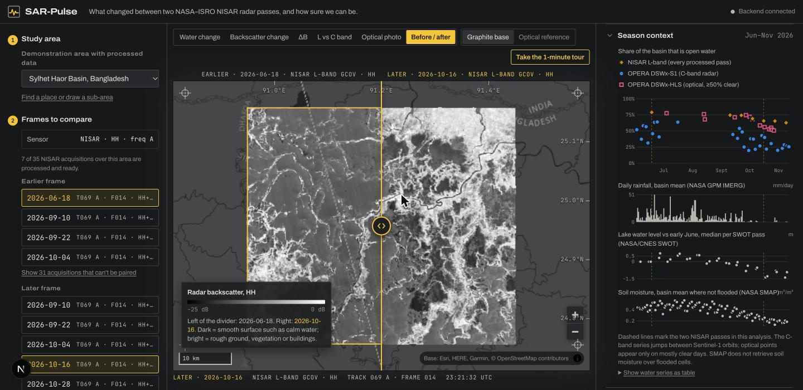
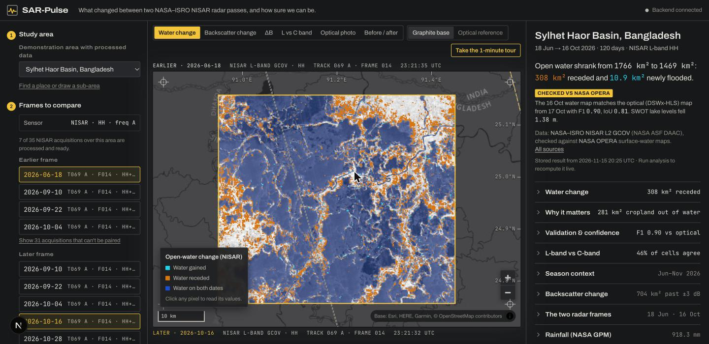
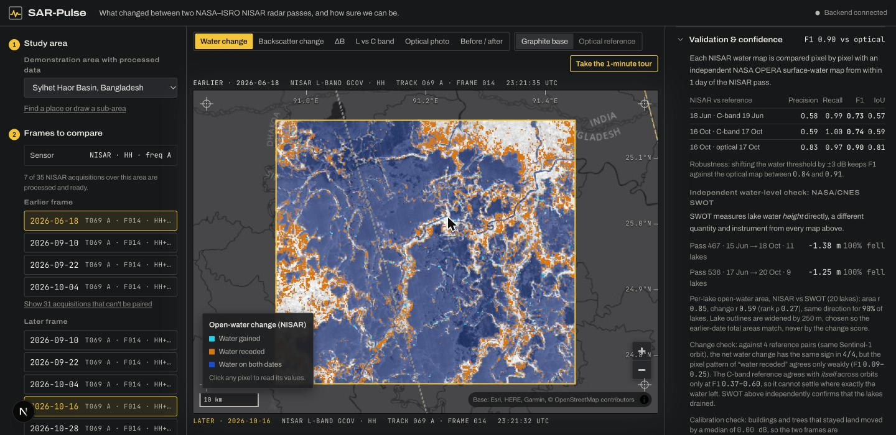
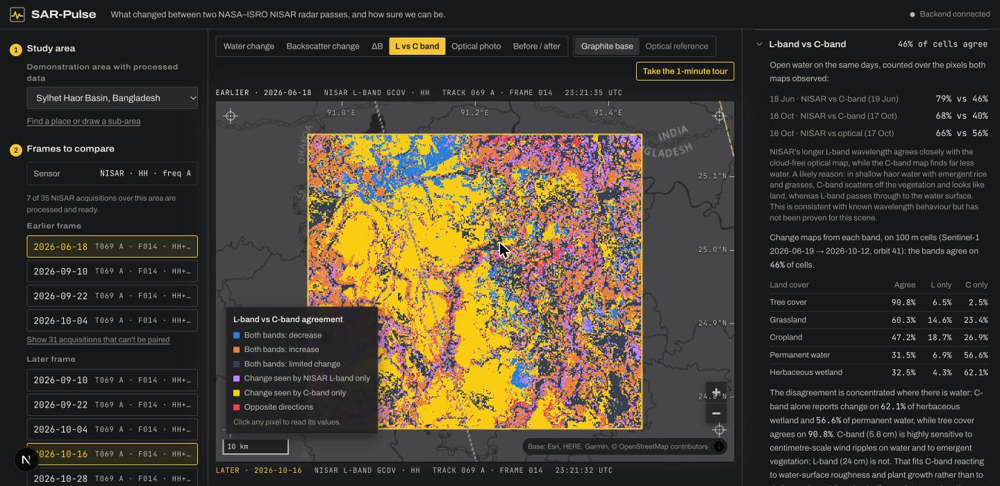
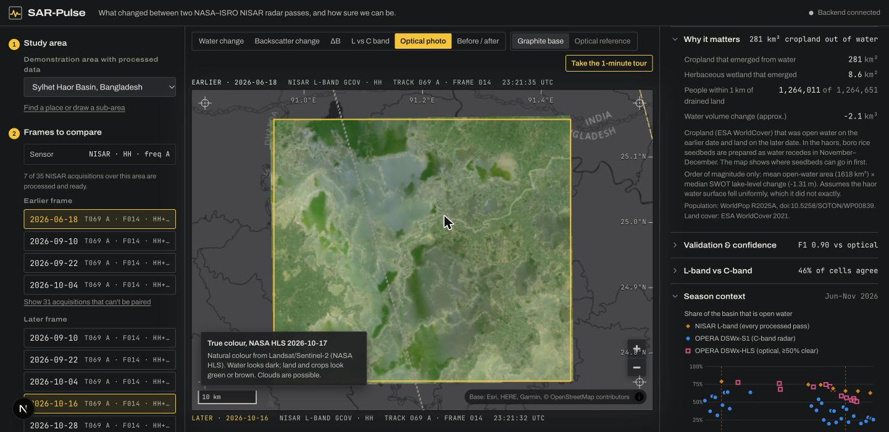

<!--
How to use this file
- Each slide is separated by a line with three dashes (---). It renders directly in Marp, Slidev or reveal.js,
  and imports into Google Slides / PowerPoint via a Markdown-to-slides converter.
- Text in HTML comments is speaker notes.
- Screenshots are in docs/presentation/ (relative paths below).
- Every number comes from the stored analyses in the live app (sylhet_monsoon, 18 Jun → 16 Oct 2026, unless stated).
- Live demo: https://nasa-spaceapps-2026.vercel.app (press "Take the 1-minute tour").
-->

# SAR-Pulse

### What changed between two NASA–ISRO NISAR radar passes, and how sure can we be?

A validated, NISAR-first tool for tracking wetland flooding and drainage through cloud.

**Case study:** monsoon drainage of the Sylhet haor wetlands, Bangladesh, June–October 2026

Live: **nasa-spaceapps-2026.vercel.app**

<!-- One sentence: we built a research tool that turns real NISAR radar into a validated water-change map, and we checked it against every independent NASA dataset we could find. -->

---

## The problem

- The **haors** of north-east Bangladesh are vast seasonal wetlands. They flood every monsoon and drain over the following months.
- About **1.26 million people** live in our 2,237 km² study basin (WorldPop 2025).
- Farmers plant **boro rice**, Bangladesh's main rice crop, as the water recedes in **November–December**. *When* and *where* land drains decides when planting can start.
- **Clouds hide the haors from optical satellites** for much of the monsoon. Radar sees through cloud, day and night.

**Question:** how much of the wetland drained between monsoon high water (18 Jun) and mid-October (16 Oct)? How well does NISAR map it? And what does L-band radar see that C-band misses?

<!-- Emphasise that this is a real, recurring, consequential problem: timing of drainage = timing of planting for a country's main rice crop. -->

---

## The data: NISAR at the centre

- **7 real NISAR L2 GCOV frames** (NASA–ISRO, from NASA's ASF DAAC): same orbit (track 69 ascending, frame 14), 18 Jun → 9 Nov 2026, about 7 GB each.
- L-band (24 cm wavelength), HH polarization, terrain-corrected backscatter on a 20 m grid.
- Compatibility checks before any comparison: same track, polarization and product. Incompatible pairs are rejected with a reason.
- **Calibration check:** buildings and trees that stayed land changed by a median of **0.00 dB** between the two passes, so the frames are radiometrically consistent.

<!-- Show the before/after swipe live: dark = smooth water, bright = land and vegetation. -->

---

## The method

1. **Speckle filter** (Lee, 5×5), then convert to dB.
2. **Open water** = HH below a threshold chosen **automatically for each image** (Otsu: −12.2 and −12.0 dB). It's only trusted if the histogram is clearly two-peaked (separability η = 0.80, 0.79).
3. **Water change:** land ↔ water between the two dates.
4. **Backscatter change** ΔB = B_later − B_earlier, with ±3 dB classes, and a noise reference.
5. **Independent checks** against every relevant NASA dataset (next slides).

The threshold is never tuned to the references we validate against.

<!-- The 'not tuned to the reference' point matters for Validity: our F1 scores are honest. -->

---

## The discovery

### Open water fell from **1,766 km²** to **1,469 km²**

- **308 km² of wetland drained**; only 11 km² newly flooded.
- NISAR's full season: **79% → 75% → 74% → 69% → 66% → 65% → 63%** of the basin is open water (18 Jun → 9 Nov).
- The monsoon switched off first. NASA GPM rainfall: **364 mm** in June, 303 in July, 308 in August, 141 in September, **24 mm** in October.

<!-- Orange on the map = water that receded. Point out it follows the haor margins and river corridors. -->

---

## Is it right? Validation against independent NASA data

| NISAR pass | NASA OPERA optical water map | F1 |
|---|---|---|
| 10 Sep | 15 Sep (Landsat-9) | **0.93** |
| 22 Sep | 27 Sep (Sentinel-2B) | **0.95** |
| 4 Oct | 4 Oct (same day) | **0.98** |
| 16 Oct | 17 Oct (Landsat-9, 100% clear) | **0.90** (IoU 0.81) |
| 28 Oct | 27 Oct (Sentinel-2B) | **0.85** |

- **Robust:** shifting the water threshold by ±3 dB keeps F1 between 0.84 and 0.91.
- **Neighbourhoods:** optical before/after (15 Sep → 17 Oct) agrees with NISAR on the *direction* of change in **93% of 500 m cells** that changed.

<!-- Five independent optical checks, F1 0.85–0.98. -->

---

## A completely different instrument agrees

**NASA/CNES SWOT** measures lake water *height* directly, a different physical quantity from every water map.

- Paired lake by lake between the SWOT passes nearest our NISAR dates, **every lake fell**:
  - **−1.38 m** median across 11 lakes (pass 467, 15 Jun → 18 Oct)
  - **−1.25 m** median across 9 lakes (pass 536, 17 Jun → 20 Oct)
  - SWOT's uncertainty is about 3–5 cm
- Per-lake water area, NISAR vs SWOT: **r = 0.85**. Per-lake area *change*: r = 0.59, with the same direction for **90%** of lakes.

<!-- This is our strongest independent evidence that the drainage is real, not a radar artefact. -->

---

## The innovation: two wavelengths, two answers

On the same pixels on 16–17 Oct, the share of the basin that is open water:

| | NISAR **L-band** (24 cm) | Sentinel-1 **C-band** (5.6 cm) | Optical |
|---|---|---|---|
| Open water | **68%** | 40% | 56% (vs NISAR 66%) |

The **optical map sides with L-band**.

**Change maps compared** (100 m cells, Sentinel-1 via NASA OPERA RTC-S1, same orbit):
- The bands agree on **91% of tree-covered cells**, but only **33% of herbaceous wetland**, where C-band alone reports change on **62%**.
- C-band reacts to wind ripples and emergent plants on shallow water; L-band largely sees through them. **For wetlands, NISAR's L-band is the better tool.**

<!-- Careful phrasing: 'consistent with known physics', not proven for every pixel. -->

---

## Why it matters

Between 18 June and 16 October:

- **281 km² of cropland** came out of the water: where boro rice seedbeds can go in first.
- About **1.26 million people** (99% of the basin) live within 1 km of land that drained.
- Roughly **2 km³** of water left the basin (order of magnitude: NISAR area × SWOT level drop).
- NASA SMAP soil moisture fell from **0.45 to 0.23 m³/m³** (June → October), so the land is drying too.

**Who could use this:** agricultural extension officers planning seedbed timing, flood and disaster agencies, and wetland conservation groups.

<!-- Tie back to the problem: timing of drainage = timing of planting. NISAR gives it every 12 days, through cloud. -->

---

## Built on NASA data

| NASA resource | Role |
|---|---|
| **NISAR L2 GCOV** (NASA–ISRO, ASF DAAC) | Primary data, 7 frames |
| **OPERA DSWx-HLS / DSWx-S1** (NASA JPL, PO.DAAC) | Independent water-map validation |
| **OPERA RTC-S1** (NASA JPL, ASF DAAC) | C-band comparison |
| **SWOT LakeSP** (NASA/CNES, PO.DAAC) | Independent lake water levels and areas |
| **GPM IMERG** (GES DISC) | Rainfall |
| **SMAP** (NSIDC DAAC) | Soil moisture |
| **HLS** (LP DAAC) | True-colour images |
| **ASF HAND** | Terrain check |
| **CMR, Earthdata Login** | Discovery and access |

**Also checked:** ICESat-2 ATL13 (no usable in-basin pair). **Non-NASA:** ESA WorldCover, JRC Global Surface Water, WorldPop, Copernicus Sentinel-1/2.

<!-- Every source is listed in the app under 'Data sources' with identifiers and links, and served at /api/sources. -->

---

## The app

- Full-bleed **map** with views for water change, backscatter change, ΔB, L vs C band, optical photo, and before/after swipe.
- **Results panel:** the answer first, then collapsible evidence (validation, wavelengths, season chart, impact, data sources).
- **1-minute guided tour** for first-time viewers. Click any pixel to read its values.
- **Live re-analysis** of any compatible pair in about 22 s. Incompatible pairs are refused with the reason.
- **Stack:**
  - Python / FastAPI backend with NumPy, rasterio/GDAL and rio-tiler.
  - Next.js / MapLibre frontend.
  - Deployed on Vercel, with data in Vercel Blob.
  - **32 automated tests.**

<!-- Show the tour live: Take the 1-minute tour. -->

---

## What we can and can't claim

**Confirmed**
- Open-water extent on each date: optical F1 0.85–0.98.
- The wetlands drained: SWOT −1.3 m; NISAR season trend; rainfall stopped.
- Which neighbourhoods drained: 93% agreement at 500 m.

**Not confirmed**
- Exact pixel edges: F1 ≈ 0.30 vs optical at 20 m.
- No field data: all references are satellites.
- Flooded vegetation under canopy can look *bright* to radar, so it may be missed as open water.
- Impact figures are indicative (2021 land cover, modelled population).

<!-- Judges reward honesty: show we measured our own limits. -->

---

## Next steps

- **Ground truth:** Bangladesh FFWC river gauges (the API exists; it needs a key from BWDB).
- **Second viewing geometry:** two more NISAR tracks over Sylhet (141 ascending, 91 descending) to confirm change patterns.
- **Operational:** run every 12-day NISAR pass automatically and alert extension offices when land drains.
- **Scale up:** other wetlands (Mekong, Pantanal, Sudd) with the same validated pipeline.

## Thank you

**Live demo:** nasa-spaceapps-2026.vercel.app · **Code and docs:** github.com/anujmish1229/nasa-spaceapps-2026

<!-- Close by restating the one-line result: NISAR mapped 308 km² of wetland draining, validated at F1 0.90 against optical and confirmed by SWOT's −1.3 m lake-level drop. -->
