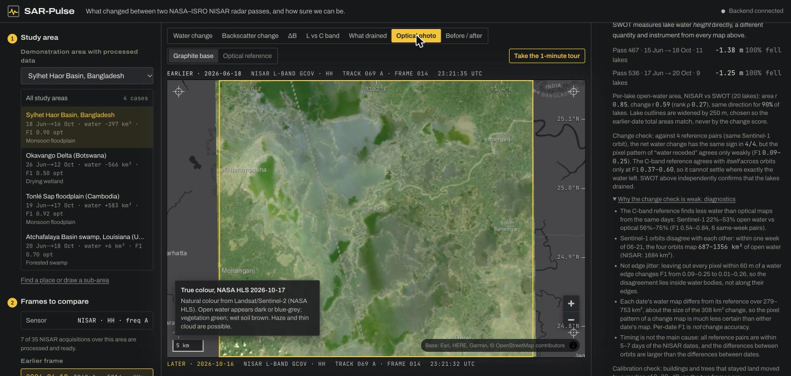
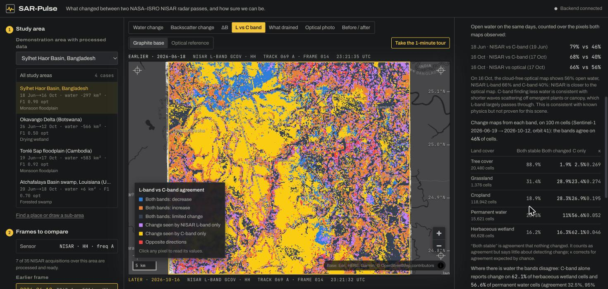
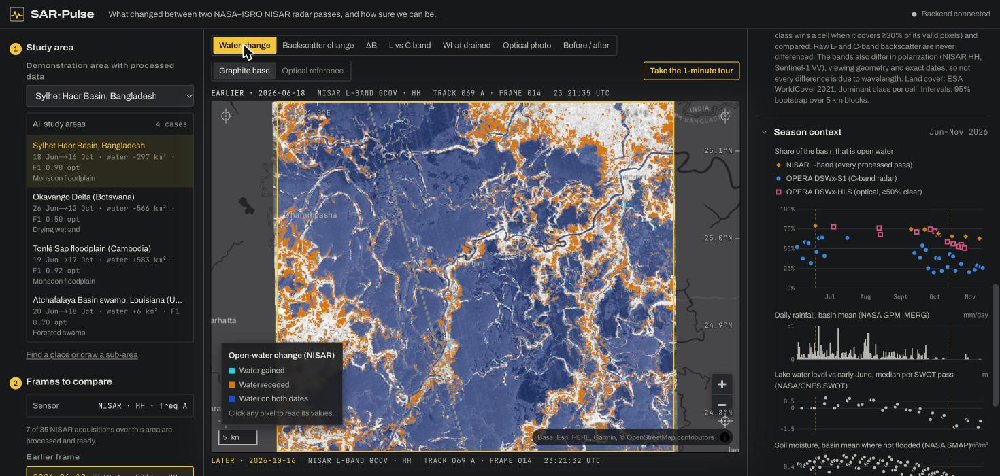
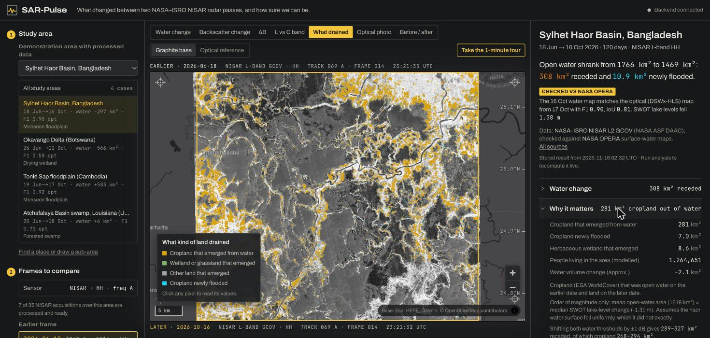
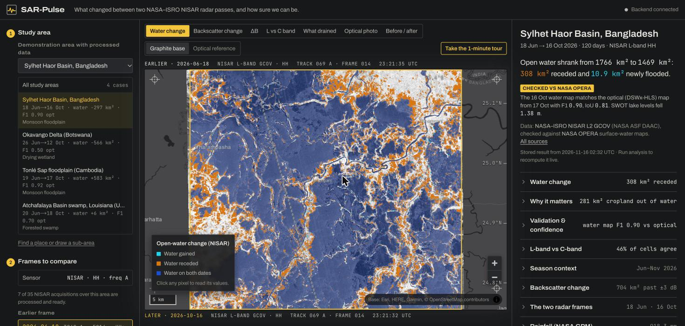

<!--
How to use this file
- Seven slides, separated by lines with three dashes (---). Renders in Marp, Slidev or reveal.js; imports into
  Google Slides / PowerPoint via a Markdown-to-slides converter. HTML comments are speaker notes.
- Screenshots are in docs/presentation/ (list at the end, with the app view that produces each one).
- Every number is traceable: the "Source" line on each slide names the stored analysis or file it comes from, all
  served by the live API (https://nasa-spaceapps-2026.vercel.app/api/...).
- The comparison radar is Sentinel-1 C-band (via NASA OPERA RTC-S1). RCM was not obtained and is not used.
-->

# 1 · Beyond the Surface

**Every monsoon, the Sylhet haor wetlands of Bangladesh flood, then drain over months. When and where the land drains decides when farmers can plant boro rice, the country's main rice crop.**

- 2,237 km² basin; about **1.26 million people** live in it (WorldPop 2025, modelled).
- Monsoon cloud hides the haors from optical satellites for most of the season. Radar sees through cloud.

**Research question:** how much of the wetland drained between monsoon high water (18 Jun 2026) and mid-October (16 Oct), how well does NASA–ISRO NISAR map it, and where do L-band and C-band radar see the surface differently?

<!-- Source: study area registry; WorldPop R2025A via /api/analysis/sylhet_monsoon (impact.people_in_area). Show the live app's Optical photo view. -->

---

# 2 · Two Wavelengths, Different Perspectives

NISAR **L-band (24 cm)** vs Sentinel-1 **C-band (5.6 cm)**, each change map made from its own sensor, compared on 100 m cells.

| Land cover (ESA WorldCover) | Cells | Agreement (95% CI) | Both stable | C-band only | κ |
|---|---|---|---|---|---|
| **Herbaceous wetland** | 66,628 | **32.5%** (27–38) | 16.2% | **62.1%** | 0.05 |
| Permanent water | 15,621 | 31.5% (27–37) | 20.5% | 56.6% | 0.05 |
| Tree cover | 20,480 | 90.8% (90–92) | **88.9%** | 2.5% | 0.27 |

- **Robust:** wetland agreement stays 31–34% across cell sizes, aggregation rules and ±1 dB thresholds.
- Tree-cover agreement is mostly *both see no change*, so it is not evidence of agreement on change.
- Same pattern in the drying **Okavango** (34%), not in the flooding **Tonlé Sap** (96%).
- *Plausible, not proven:* C-band reacts more to wind ripples and emergent plants. Polarization (HH vs VV) and geometry differ too.

<!-- Source: /api/analysis/sylhet_monsoon → sensor_comparison.by_landcover; robustness: /api/analysis/sylhet_monsoon/diagnostics (C_l_vs_c). -->

---

# 3 · From Radar to Environmental Intelligence

1. **Discover** NISAR L2 GCOV frames in NASA CMR; check compatibility (same track, frame, polarization, product). Incompatible pairs are refused with a reason; mixed product versions are flagged.
2. **Read** only the study-area window from each ~7 GB HDF5 file over HTTPS (Earthdata Login).
3. **Calibrate and filter:** linear γ⁰ → Lee speckle filter → dB; invariant-target check (median ΔB on unchanged land, tolerance 0.5 dB).
4. **Map water** per image with an automatic Otsu threshold, used only when the histogram is clearly two-peaked (η ≥ 0.7).
5. **Change:** water lost / gained, ΔB classes (±3 dB).
6. **Validate** against independent NASA data: OPERA DSWx-HLS (optical), DSWx-S1 and RTC-S1 (C-band), SWOT lake heights; context from GPM rainfall, SMAP soil moisture, HLS imagery, HAND, WorldCover, WorldPop.
7. **Serve** as map tiles + statistics (FastAPI, rio-tiler, Next.js/MapLibre on Vercel).

Thresholds are never tuned to the references used for validation.

<!-- Source: backend/processing/pipeline.py; docs/methodology.md. 41 tests: 36 synthetic, 5 on the real Sylhet data. -->

---

# 4 · Following the Monsoon (Sylhet)

**Seven NISAR passes, one orbit (track 69 ascending), 18 Jun → 9 Nov 2026**

- NISAR open water: **79% → 75% → 74% → 69% → 66% → 65% → 63%** of the basin.
- NASA GPM rainfall: **364 mm** (Jun), 303, 308, 141, **24 mm** (Oct): the monsoon switched off first.
- NASA/CNES **SWOT**: every observed lake fell, median **−1.38 m** (11 lakes) and **−1.25 m** (9 lakes).
- NASA **SMAP** soil moisture: 0.45 → 0.23 m³/m³.

<!-- Source: /api/study-areas/sylhet_haor/nisar-season, /rainfall, /swot, /soil-moisture. Timing coincidence is not proof of cause. -->

---

# 5 · What the Satellites Revealed

### Open water fell from **1,766 km²** to **1,469 km²** (18 Jun → 16 Oct)

- **308 km² receded** (289–327 km² for thresholds ±1 dB); 11 km² newly flooded.
- **281 km² of it is cropland** (268–294 km²): where boro seedbeds can go in first.
- ≈ **2 km³** of water left the basin (order of magnitude: area × SWOT level drop).
- Three more ecosystems, same pipeline, no tuning (Okavango is the weak case; Atchafalaya's under-canopy flooding is not open water):

| Area | Pair | Water | Best F1 (optical) |
|---|---|---|---|
| Okavango delta (drying) | 26 Jun → 12 Oct | 644 → 78 km² | 0.50 |
| Tonlé Sap (flooding) | 19 Jun → 17 Oct | 1,046 → 1,629 km² | 0.92 |
| Atchafalaya swamp forest | 20 Jun → 18 Oct | 192 → 199 km² | 0.70 |

<!-- Source: /api/analysis/sylhet_monsoon (water, impact); /api/analysis/sylhet_monsoon/diagnostics (D_impact); /api/summary. -->

---

# 6 · Measuring Confidence

**Water map on each date (single-date accuracy):** optical F1 **0.93, 0.95, 0.98, 0.90, 0.85** at five dates; ±3 dB threshold keeps F1 0.84–0.91.

**Change map (a different, lower number):**
- Direction of change agrees with optical in **93% of 500 m cells**; pixel F1 0.30.
- Against C-band: F1 0.09–0.25. Why: the C-band reference finds 15–47 points less water than optical on the same days, its four orbits disagree by 2× in June, and the disagreement lies *inside* water bodies, not at edges.
- **Independent instrument:** SWOT confirms the lakes drained.

**Calibration check** catches problems: 0.00 dB for the main pair; flagged for a mixed-version pair (−0.72 dB) and for Tonlé Sap (−0.63 dB).

**Not confirmed:** exact pixel edges of drainage; no field data; no depth.

<!-- Source: /api/analysis/sylhet_monsoon (validation), /api/analysis/sylhet_recession, /api/analysis/sylhet_monsoon/diagnostics. Okavango is the weak case: F1 0.19–0.59; NISAR over-calls water on dry sand / under-calls vs optical partial water. -->

---

# 7 · Beyond Detection

**What it gives:** every 12 days, through cloud, a validated map of where water left and what land emerged.

- **Users:** agricultural extension officers (seedbed timing), flood and disaster agencies, wetland conservation.
- **Shown at four sites** on three continents; the pipeline runs any new area with one command.
- **Honest about limits:** proximity of 1.26 M people to drained land is exposure context, not harm; land cover is a single 2021 map; references are satellites, not field data.

**Next:** Bangladesh FFWC river gauges (needs a BWDB key) for ground truth · second NISAR geometry (tracks 141 A, 91 D) · automatic runs on every new pass.

**Live:** nasa-spaceapps-2026.vercel.app · **Code:** github.com/anujmish1229/nasa-spaceapps-2026

<!-- Close: NISAR mapped 308 km² of wetland draining, validated per date at F1 0.85–0.98 against optical, confirmed by SWOT's −1.3 m, and showed where L- and C-band disagree, with that disagreement tested for robustness. -->

---

<!--
Screenshots (docs/presentation/), each from the live app at 1440×900:
- s1-optical-photo.jpg  Sylhet, map view "Optical photo" (HLS 17 Oct true colour), results panel collapsed to the headline.
- s2-l-vs-c.jpg         Map view "L vs C band"; panel fold "L-band vs C-band" open (land-cover table with Both stable / C only / κ).
- s3-app-overview.jpg   Default view on load: Water change map + results headline (shows the whole tool).
- s4-season.jpg         Fold "Season context" open (NISAR season, rainfall, SWOT, SMAP panels).
- s5-what-drained.jpg   Map view "What drained" (cropland emerged in amber); fold "Why it matters" open with ±1 dB ranges.
- s6-validation.jpg     Fold "Validation & confidence" open with "Why the change check is weak: diagnostics" expanded.
- s7-areas.jpg          Tool tray "All study areas" list (four cases).
-->
